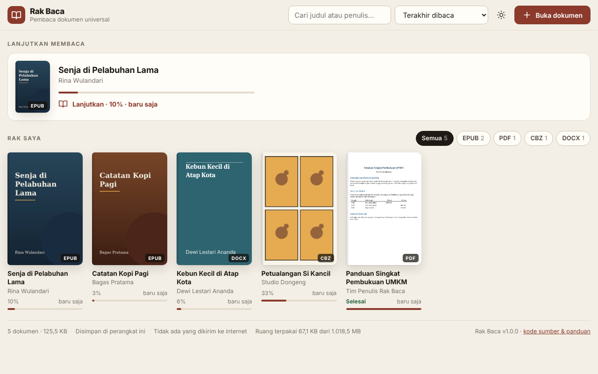
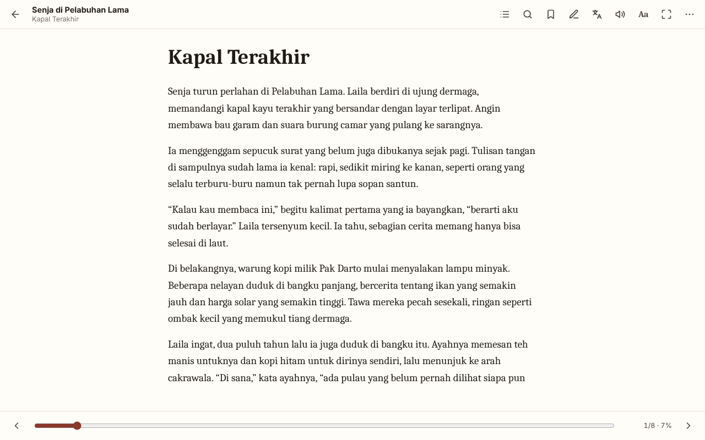
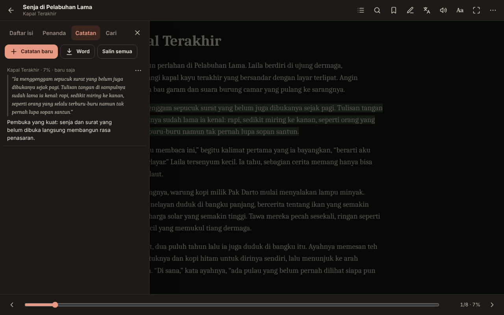
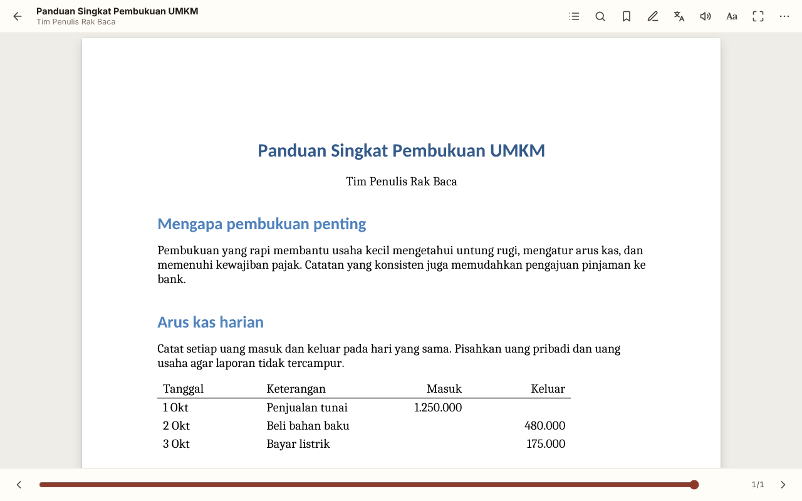
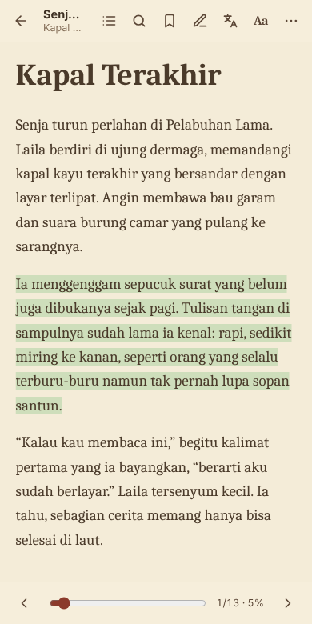

# Rak Baca

**Pembaca dokumen universal yang bekerja tanpa internet.** Buka PDF, EPUB, MOBI, FB2, DOCX, ODT, RTF, TXT, Markdown, HTML, CSV, gambar, dan komik dalam satu aplikasi. Dokumen dibaca langsung di perangkat Anda dan tidak pernah diunggah ke mana pun.

**[▶ Coba langsung di peramban](https://ciesha97.github.io/rak-baca/)** · **[⬇ Unduh (Windows / satu berkas HTML)](https://github.com/Ciesha97/rak-baca/releases/latest)**



## Fitur

- **Satu aplikasi untuk semua dokumen.** Tidak perlu memasang pembaca PDF, pembaca EPUB, dan Word secara terpisah.
- **Rak buku** dengan sampul otomatis, pencarian judul/penulis, filter format, dan kartu *Lanjutkan membaca*. Posisi terakhir setiap dokumen selalu diingat.
- **Nyaman dibaca lama:** tema terang, sepia, dan gelap; huruf serif/sans/mono; ukuran huruf, spasi baris, dan lebar teks bisa diatur; tata letak 1 kolom, 2 kolom, atau gulir.
- **Daftar isi, pencarian, dan penanda halaman.** Pencarian mengabaikan huruf besar/kecil dan tanda aksen.
- **Catatan:** blok kutipan saat membaca, tambahkan insight Anda sendiri, lalu ekspor semua catatan ke **Word (.docx)**.
- **Terjemahan ke bahasa Indonesia** untuk teks pilihan atau satu halaman (penerjemah bawaan Chrome, berjalan di perangkat).
- **Bacakan:** teks dibacakan dengan suara (text-to-speech) sambil paragraf yang dibaca disorot.
- **PDF lengkap:** teks bisa dipilih dan dicari, tautan dan kerangka (outline) berfungsi, PDF berkata sandi dan hasil pindaian (JBIG2/JPEG2000) bisa dibuka, plus mode halaman gelap.
- **Catatan kaki** muncul sebagai jendela kecil; setelah melompat lewat tautan ada tombol *Kembali ke posisi tadi*.
- **Bisa di komputer dan ponsel.** Geser untuk berganti halaman, cubit untuk memperbesar PDF/komik.

| Membaca (1 kolom) | Catatan + tema gelap |
|---|---|
|  |  |

| PDF | Ponsel (tema sepia) |
|---|---|
|  |  |

## Format yang didukung

| Jenis | Format |
|---|---|
| Buku elektronik | EPUB (2 & 3), MOBI / PRC / AZW tanpa DRM, FB2 (juga `.fb2.zip`) |
| Dokumen | PDF, DOCX (Word), ODT (LibreOffice), RTF |
| Teks | TXT (UTF-8, UTF-16, Windows-1252), Markdown, HTML, CSV/TSV (jadi tabel), JSON, XML, log, berkas kode |
| Gambar & komik | JPG, PNG, WEBP, GIF, BMP, SVG, AVIF, CBZ, ZIP berisi satu dokumen |

**Belum didukung:** buku ber-DRM, AZW3/KF8, MOBI berkompresi HUFF/CDIC, DOC/XLS/PPT lama, XLSX, PPTX, CBR (RAR). Simpan ulang sebagai PDF, DOCX, atau EPUB lalu buka lagi.

## Cara memakai

Pilih salah satu:

1. **Versi online.** Buka **https://ciesha97.github.io/rak-baca/** di Chrome atau Edge (paling teruji). Firefox dan Safari versi terbaru seharusnya juga bisa. Tidak perlu daftar atau memasang apa pun. Meski dibuka dari internet, dokumen tetap dibaca di perangkat Anda sendiri.
2. **Satu berkas HTML (bisa tanpa internet sama sekali).** Unduh `rak-baca.html` dari halaman [Releases](https://github.com/Ciesha97/rak-baca/releases/latest), lalu klik dua kali untuk membuka di peramban. Berkas ini bisa disalin ke flashdisk atau dikirim ke orang lain.
3. **Aplikasi Windows.** Unduh `Rak-Baca-Setup-<versi>.exe` (dengan installer) atau `Rak-Baca-Portable.exe` (langsung jalan) dari [Releases](https://github.com/Ciesha97/rak-baca/releases/latest). Setelah dipasang, dokumen bisa dibuka lewat klik kanan → *Open with* → *Rak Baca*.
   > Installer belum ditandatangani (code signing), jadi Windows SmartScreen akan menampilkan "Windows protected your PC". Klik **More info** → **Run anyway**.

Lalu klik **Buka dokumen** atau seret berkas ke jendela.

### Pintasan keyboard di layar baca

| Tombol | Fungsi |
|---|---|
| → / ← , PageDown / PageUp, Spasi | halaman berikutnya / sebelumnya |
| Home / End | awal / akhir dokumen |
| Ctrl+F atau / | cari |
| T | daftar isi |
| B | tandai halaman |
| N | catatan baru (memakai teks yang diblok) |
| E | terjemahkan ke bahasa Indonesia |
| R | bacakan |
| C | ganti 1 kolom / 2 kolom |
| F / M | layar penuh / mode fokus |
| + / − | ukuran huruf atau perbesaran |
| Esc | tutup panel, lalu kembali ke rak |

Di rak: **Ctrl+O** membuka berkas, **/** ke kotak pencarian.

## Privasi & keamanan

- **Tidak ada yang dikirim ke internet.** Halaman memakai Content-Security-Policy yang melarang dokumen memuat apa pun dari internet (gambar, skrip, font, pelacak). Tautan luar di dalam dokumen hanya terbuka bila Anda mengkliknya.
- **Isi dokumen disaring.** Halaman dokumen dibangun ulang hanya dari elemen dan atribut yang aman, sehingga skrip, iframe, formulir, *event handler*, dan tautan `javascript:` dari dokumen tidak pernah berjalan.
- **Penyimpanan lokal.** Salinan dokumen, posisi baca, penanda, dan catatan disimpan di penyimpanan peramban (IndexedDB) atau, di aplikasi Windows, di `%APPDATA%\Rak Baca`. Peramban lain atau mode penyamaran punya rak sendiri.
  > ⚠️ **Menghapus data situs/riwayat peramban juga menghapus rak dan catatan Anda.** Ekspor catatan penting ke Word secara berkala.
- **Terjemahan:** penerjemah bawaan Chrome (versi 138 ke atas di komputer) berjalan di perangkat. Di peramban lain tersedia tombol *Buka di Google Terjemahan*. Teks baru dikirim ke Google setelah Anda mengklik tombol itu.

## Untuk pengembang

Rak Baca ditulis dengan HTML, CSS, dan JavaScript biasa tanpa framework dan tanpa langkah bundling. [pdf.js](https://github.com/mozilla/pdf.js) disertakan di `vendor/pdfjs/`.

```
src/            kode sumber: page.html (tampilan & CSS) + 1-core … 6-shelf.js
vendor/pdfjs/   pdf.js dari Mozilla (Apache-2.0)
tools/          build.sh, make-samples.js, test-reader.js, update-pdfjs.sh
desktop/        aplikasi desktop Electron + konfigurasi installer
docs/           tangkapan layar untuk README
rak-baca.html   hasil build: seluruh aplikasi dalam satu berkas
```

```sh
sh tools/build.sh                         # src/ + pdf.js → rak-baca.html & desktop/app/index.html
node tools/make-samples.js /tmp/contoh    # dokumen contoh semua format
npm i --no-save playwright                # sekali saja
node tools/test-reader.js /tmp/contoh     # ±140 pemeriksaan di Chromium
RAK_URL=http://localhost:8000/ node tools/test-reader.js /tmp/contoh   # uji lewat server
sh tools/update-pdfjs.sh 6.4.299          # ganti versi pdf.js
```

Aplikasi desktop (butuh Node.js 22+):

```sh
cd desktop
npm ci
npm start            # jalankan
npm run dist:win     # installer + versi portable di desktop/dist
```

**Rilis:** naikkan `version` di `desktop/package.json`, jalankan `sh tools/build.sh`, commit, lalu buat tag `v<versi>` (mis. `v1.0.1`) atau buat Release dengan tag itu di GitHub. Workflow akan menguji semua format, membuat installer Windows, lalu melampirkan installer dan `rak-baca.html` ke halaman rilis. Setiap push ke `main` juga memperbarui versi online di GitHub Pages.

Laporan bug dan usulan fitur sangat diterima lewat [Issues](https://github.com/Ciesha97/rak-baca/issues). Sertakan versi (tertulis di kaki halaman rak), peramban/perangkat, dan bila bisa, contoh dokumennya.

## Lisensi

[MIT](LICENSE): bebas dipakai, diubah, dan dibagikan, termasuk untuk keperluan komersial, asal mencantumkan pemberitahuan hak cipta.

Komponen pihak ketiga: pdf.js © Mozilla Foundation, lisensi Apache-2.0 (`vendor/pdfjs/LICENSE`); dekoder JBIG2 dan OpenJPEG mengikuti lisensinya masing-masing (`vendor/pdfjs/LICENSE-WASM`).

---

### English

**Rak Baca** ("reading shelf") is an offline, universal document reader that runs entirely in your browser (or as a Windows app). It opens PDF, EPUB, MOBI, FB2, DOCX, ODT, RTF, TXT, Markdown, HTML, CSV, images, and CBZ comics. It also has a library with covers and reading progress, adjustable typography, themes, search, bookmarks, notes with Word export, text-to-speech, and on-device translation into Indonesian. Documents never leave your device. [Try it online](https://ciesha97.github.io/rak-baca/) or download a release. The interface is in Indonesian. MIT licensed.
